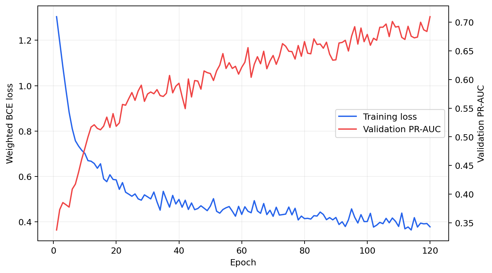
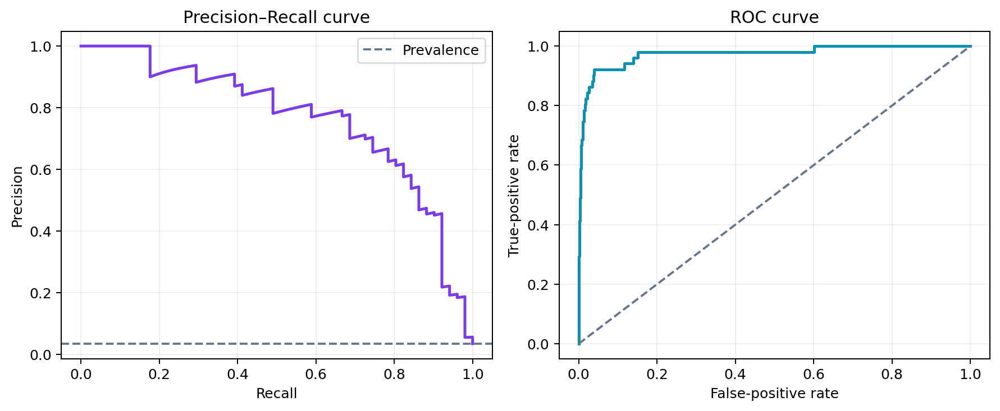
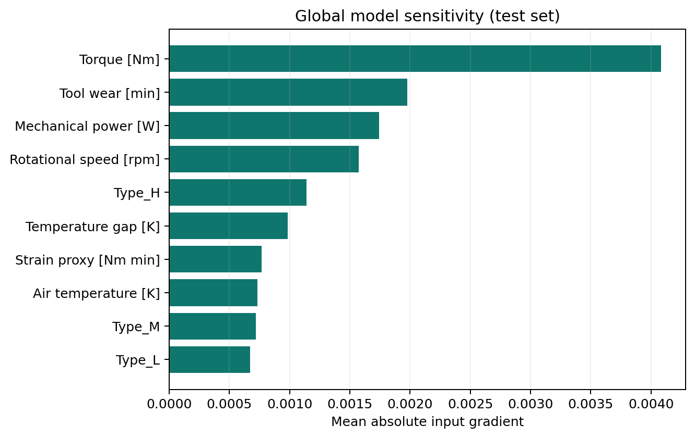

# Industrial Predictive Maintenance with PyTorch

[](https://www.python.org/)
[](https://pytorch.org/)
[](LICENSE)
[](data/README.md)

An end-to-end deep-learning portfolio project that estimates industrial
equipment failure risk from operating conditions. It includes a reproducible
training pipeline, explicit leakage controls, class-imbalance handling,
probability calibration, model interpretation, tests, and a Streamlit demo.

**Author:** Halil Sirvan — Industrial Engineer and Computer Engineering M.Sc.

## Why this project

Unexpected machine failure creates downtime, missed production, and emergency
maintenance cost. The useful question is not simply "what is the most accurate
classifier?" Because failures are rare, the operational question is:

> How many real failures can we detect without overwhelming maintenance teams
> with false alarms?

The dataset contains only **3.39% failures**, so accuracy alone would be
misleading. This project therefore emphasizes PR-AUC, failure-class recall,
precision, F1, calibration, and the confusion matrix.

## Test-set results

The test set was held out before preprocessing, calibration, and threshold
selection. Threshold selection used validation data only.

| Metric | Result |
|---|---:|
| ROC-AUC | **0.974** |
| PR-AUC | **0.767** |
| Failure precision | **0.618** |
| Failure recall | **0.824** |
| Failure F1 | **0.706** |
| Brier score | **0.015** |
| Test failures detected | **42 / 51** |
| False maintenance alerts | **26 / 1,500 test records** |





## Modeling approach

1. Stratified train/validation/test split: 70% / 15% / 15%.
2. Preprocessing fitted on the training partition only.
3. Numeric standardization and one-hot encoding of product type.
4. Three domain-motivated, label-independent interaction features:
   - process-to-air temperature gap;
   - mechanical power from torque and rotational speed;
   - torque–tool-wear strain proxy.
5. Compact PyTorch multilayer perceptron: `input → 32 → 16 → 1`, with batch
   normalization, ReLU, dropout, and AdamW.
6. Weighted binary cross-entropy to address the rare failure class.
7. Platt calibration fitted on validation logits.
8. Decision threshold selected on validation data to maximize failure-class F1.

### Leakage control

The dataset contains five failure-mode flags (`TWF`, `HDF`, `PWF`, `OSF`, and
`RNF`). They reveal the causes used to construct the target. Passing them to a
model would create unrealistically high performance, so the pipeline explicitly
excludes them together with identifiers and the target column. A unit test
protects this rule.



The sensitivity plot uses mean absolute input gradients over the untouched test
set. It is a global diagnostic, not a causal claim.

## Repository structure

```text
.
├── app.py                    # Streamlit risk-estimation demo
├── artifacts/                # Trained model, preprocessor, calibrator, metadata
├── assets/                   # Metrics, curves, and model diagnostics
├── data/                     # UCI AI4I CSV and attribution
├── src/
│   ├── data.py               # Schema checks and leakage-safe features
│   ├── inference.py          # Reusable local prediction API
│   ├── model.py              # PyTorch MLP
│   └── train.py              # Training, calibration, evaluation, persistence
└── tests/test_pipeline.py    # Leakage, feature, and tensor-shape tests
```

## Run locally

```bash
python -m venv .venv
source .venv/bin/activate              # Windows: .venv\Scripts\activate
python -m pip install torch --index-url https://download.pytorch.org/whl/cpu
python -m pip install -r requirements.txt
python -m pip install -r requirements-dev.txt

python -m pytest -q
python -m src.train
python -m streamlit run app.py
```

The repository already contains reproducibly trained artifacts. Run the last
command to open the demo immediately.

## Example inference

```python
import pandas as pd
from src.inference import FailurePredictor

predictor = FailurePredictor("artifacts")
sample = pd.DataFrame([{
    "Type": "L",
    "Air temperature [K]": 303.0,
    "Process temperature [K]": 310.0,
    "Rotational speed [rpm]": 1250,
    "Torque [Nm]": 65.0,
    "Tool wear [min]": 220,
}])
print(predictor.predict(sample))
```

## Dataset and attribution

This project uses the **AI4I 2020 Predictive Maintenance Dataset**, a synthetic
dataset designed to reflect real industrial operating data.

- UCI Machine Learning Repository, dataset ID 601
- DOI: [10.24432/C5HS5C](https://doi.org/10.24432/C5HS5C)
- 10,000 records, six original model features, no missing values
- Data license: CC BY 4.0

See [data/README.md](data/README.md) for attribution details.

## Limitations and next steps

- The source data is synthetic and predicts failure at the current observation,
  not remaining useful life or a future time horizon.
- A random stratified split is appropriate for this benchmark but a production
  deployment would require machine-aware or time-based validation.
- The model is a portfolio demonstration, not a safety-certified decision tool.
- The next production step would add streaming sensor ingestion, drift checks,
  a cost-sensitive threshold, and external validation on plant data.

## CV-ready project bullet

> Built an end-to-end PyTorch predictive-maintenance system on 10,000 industrial
> sensor records; prevented target leakage, handled a 3.4% rare-event class,
> calibrated probabilities, and achieved 0.974 ROC-AUC / 0.767 PR-AUC with 82.4%
> failure recall on a held-out test set; delivered a tested Streamlit demo.

## Application materials

- [Turkish interview notes](PROJECT_BRIEF_TR.md)
- [Two-minute live demo script](DEMO_SCRIPT_TR.md)
- [GitHub, LinkedIn, CV and application copy](APPLICATION_PACK_TR.md)
- [Model card](MODEL_CARD.md)

